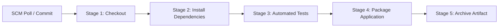

# TaskFlow – Task Management REST API (DevOps Component 1)

TaskFlow is a lightweight, beginner-friendly REST API built with Node.js and Express.js using in-memory data storage. This project serves as **Component 1** of an academic DevOps Project-Based Learning (PBL) assignment, establishing the foundational application codebase, comprehensive automated testing, reproducible artifact packaging, and a continuous integration (CI) pipeline definition with Jenkins.

---

## 1. Project Introduction

TaskFlow provides a minimal task management service designed to demonstrate fundamental DevOps practices:
- Writing clean, modular backend application code.
- Implementing test-driven automated quality gates.
- Creating reproducible release artifacts (`.tgz`) via npm packaging.
- Automating the build, test, and packaging lifecycle through a Jenkins Declarative CI Pipeline.

---

## 2. Problem Statement and Objective

In modern software engineering, manual testing and manual builds lead to configuration drift, deployment inconsistencies, and undetected regression bugs. 

**Objective:**
1. Develop a simple, reliable REST API for task management with in-memory persistence.
2. Establish automated testing using Jest and Supertest to guarantee API contract compliance and input validation.
3. Build a reproducible distribution package artifact excluding development dependencies, tests, and configuration files.
4. Define a Declarative Jenkins CI Pipeline with continuous SCM polling to automatically validate code and archive build artifacts upon every commit.

---

## 3. Technology Stack

- **Runtime Environment:** Node.js (v24.x compatible)
- **Web Framework:** Express.js 4.x
- **Testing Framework:** Jest 29.x & Supertest 7.x
- **Build & Packaging:** npm (`npm pack`)
- **CI / Pipeline Automation:** Jenkins (Declarative Pipeline)
- **Version Control:** Git & GitHub

---

## 4. Project Folder Structure

```text
taskflow/
├── .gitignore               # Git ignore rules (node_modules, dist, coverage, logs, etc.)
├── .npmignore               # Packaging ignore rules (excludes tests, scripts, Jenkinsfile)
├── Jenkinsfile              # Jenkins Declarative Pipeline script
├── package.json             # Project metadata, scripts, and dependencies
├── package-lock.json        # Pinned dependency lockfile for reproducible builds
├── README.md                # Comprehensive project documentation
├── scripts/
│   └── package.js           # Build script to generate .tgz artifact inside dist/
├── src/
│   ├── app.js               # Express application setup, middleware, and route mounting
│   ├── server.js            # Server entrypoint listening on configurable PORT (default 8080)
│   ├── routes/
│   │   ├── healthRoutes.js  # /health endpoint route
│   │   └── taskRoutes.js    # /api/tasks endpoint routes (GET, POST)
│   └── services/
│       └── taskService.js   # In-memory task business logic and reset utility
└── tests/
    ├── health.test.js       # Health endpoint automated tests
    └── task.test.js         # Task endpoints automated tests (GET, POST, validation)
```

---

## 5. API Endpoint Documentation

### Base URL
By default, the server runs at: `http://localhost:8080`

### Endpoints Overview

| Method | Endpoint | Description | Status Codes |
| :--- | :--- | :--- | :--- |
| **GET** | `/health` | Check service health status | `200 OK` |
| **GET** | `/api/tasks` | Retrieve all tasks | `200 OK` |
| **GET** | `/api/tasks/:id` | Retrieve a single task by ID | `200 OK`, `404 Not Found` |
| **POST** | `/api/tasks` | Create a new task | `201 Created`, `400 Bad Request` |

---

### A. Health Check: `GET /health`

**Description:** Returns the operational health status of the application.

**Sample Request:**
```http
GET /health HTTP/1.1
Host: localhost:8080
```

**Sample Response (HTTP 200 OK):**
```json
{
  "status": "healthy",
  "timestamp": "2026-11-22T15:40:00.000Z"
}
```

---

### B. List Tasks: `GET /api/tasks`

**Description:** Retrieves all tasks stored in memory. Returns an empty array `[]` if no tasks exist.

**Sample Request:**
```http
GET /api/tasks HTTP/1.1
Host: localhost:8080
```

**Sample Response (HTTP 200 OK):**
```json
[
  {
    "id": 1,
    "title": "Complete DevOps Assignment",
    "createdAt": "2026-11-22T15:42:10.500Z"
  }
]
```

---

### C. Create Task: `POST /api/tasks`

**Description:** Accepts a JSON body with a `title` field, validates the title, creates the task with a unique numerical ID, and stores it in memory.

**Sample Request (Valid Input):**
```http
POST /api/tasks HTTP/1.1
Host: localhost:8080
Content-Type: application/json

{
  "title": "Prepare Jenkins CI Pipeline"
}
```

**Sample Response (HTTP 201 Created):**
```json
{
  "id": 2,
  "title": "Prepare Jenkins CI Pipeline",
  "createdAt": "2026-11-22T15:43:00.120Z"
}
```

**Sample Request (Invalid Input - Missing Title):**
```http
POST /api/tasks HTTP/1.1
Host: localhost:8080
Content-Type: application/json

{}
```

**Sample Response (HTTP 400 Bad Request):**
```json
{
  "error": "Task title is required and must not be empty."
}
```

**Sample Request (Invalid Input - Empty String / Spaces):**
```http
POST /api/tasks HTTP/1.1
Host: localhost:8080
Content-Type: application/json

{
  "title": "   "
}
```

**Sample Response (HTTP 400 Bad Request):**
```json
{
  "error": "Task title is required and must not be empty."
}
```

---

### D. Get Task by ID: `GET /api/tasks/:id`

**Description:** Retrieves the task matching the supplied `id`. Returns HTTP 200 with the task if found, or HTTP 404 with a descriptive JSON error if the task does not exist.

**Sample Request (Existing Task):**
```http
GET /api/tasks/1 HTTP/1.1
Host: localhost:8080
```

**Sample Response (HTTP 200 OK):**
```json
{
  "id": 1,
  "title": "Complete DevOps Assignment",
  "createdAt": "2026-11-22T15:42:10.500Z"
}
```

**Sample Request (Non-Existent Task):**
```http
GET /api/tasks/999 HTTP/1.1
Host: localhost:8080
```

**Sample Response (HTTP 404 Not Found):**
```json
{
  "error": "Task with ID 999 not found."
}
```

---

## 6. Installation Instructions

### Prerequisites
- **Node.js**: v18.x, v20.x, or v24.x
- **npm**: v9.x or higher
- **PowerShell** or terminal of your choice

### Install Dependencies
Clone the repository (or navigate into the project root directory) and run:

```powershell
npm install
```

For production or CI environments with an existing `package-lock.json`:
```powershell
npm ci
```

---

## 7. Commands to Run the Application

### Start Application (Production / Standard)
```powershell
npm start
```
*Output:*
```text
TaskFlow server is running on http://localhost:8080
```

### Start Application (Development Watch Mode)
```powershell
npm run dev
```

### Configure Port (Optional)
To use a different port (e.g., 3000):
```powershell
$env:PORT="3000"; npm start
```

---

## 8. Instructions to Test Endpoints Using PowerShell

Open a separate PowerShell window while the server is running:

### 1. Test Health Endpoint
```powershell
Invoke-RestMethod -Uri "http://localhost:8080/health" -Method Get
```

### 2. Get All Tasks (Initially Empty)
```powershell
Invoke-RestMethod -Uri "http://localhost:8080/api/tasks" -Method Get
```

### 3. Create a Task (Valid POST)
```powershell
$body = @{ title = "My First Task" } | ConvertTo-Json
Invoke-RestMethod -Uri "http://localhost:8080/api/tasks" -Method Post -Body $body -ContentType "application/json"
```

### 4. Get Task by ID (Found)
```powershell
Invoke-RestMethod -Uri "http://localhost:8080/api/tasks/1" -Method Get
```

### 5. Get Task by ID (Not Found - 404)
```powershell
try {
    Invoke-RestMethod -Uri "http://localhost:8080/api/tasks/999" -Method Get
} catch {
    $_.ErrorDetails.Message
}
```

### 6. Test Validation Error (Empty Title)
```powershell
try {
    $badBody = @{ title = " " } | ConvertTo-Json
    Invoke-RestMethod -Uri "http://localhost:8080/api/tasks" -Method Post -Body $badBody -ContentType "application/json"
} catch {
    $_.Exception.Response.StatusCode
    $_.ErrorDetails.Message
}
```

### Testing with `curl` (Cross-Platform)
```bash
# Health check
curl -X GET http://localhost:8080/health

# List tasks
curl -X GET http://localhost:8080/api/tasks

# Create task
curl -X POST http://localhost:8080/api/tasks \
  -H "Content-Type: application/json" \
  -d '{"title": "DevOps Task via curl"}'
```

---

## 9. Instructions to Execute Automated Tests

Run the test suite using Jest in CI mode:

```powershell
npm test
```

### What this command executes:
- Runs `jest --ci --colors`
- Tests `tests/task.test.js` and `tests/health.test.js`
- Returns exit code `0` on success and non-zero exit code on failure (critical for CI pipeline gating).

---

## 10. Instructions to Generate the Package Artifact

The assignment requires creating a deployable build artifact using npm packaging.

Run:
```powershell
npm run package
```

### What this script does:
1. Checks for the `dist/` directory and creates it if it does not exist.
2. Cleans any previously generated `.tgz` files inside `dist/`.
3. Runs `npm pack --pack-destination dist`.
4. Uses `.npmignore` and the `files` array in `package.json` to ensure only runtime code (`src/`, `package.json`, `README.md`) is packaged, excluding test files, git history, and build scripts.
5. Saves the output file: `dist/taskflow-api-1.0.0.tgz`.

### Verifying the Package
You can test-install and inspect the package artifact anywhere by running:
```powershell
npm install ./dist/taskflow-api-1.0.0.tgz
```

---

## 11. Explanation of the Jenkins Pipeline Stages

The root-level `Jenkinsfile` defines a 5-stage Declarative Pipeline:



1. **SCM Polling Trigger (`triggers { pollSCM('* * * * *') }`):**
   - Polls the Git repository every minute for newly pushed commits. When a change is detected, Jenkins triggers a new build automatically.
2. **Stage 1: Checkout:**
   - Clones the Git repository and switches to the triggered commit using `checkout scm`.
3. **Stage 2: Install Dependencies:**
   - Executes `npm ci`. Unlike `npm install`, `npm ci` strictly honors `package-lock.json` and deletes any existing `node_modules` for a pristine, deterministic environment.
   - *Requirement:* The Jenkins agent must have Node.js and npm installed and available on `PATH`.
4. **Stage 3: Automated Tests:**
   - Executes `npm test` (`jest`).
   - If any unit or integration test fails, Jest returns a non-zero exit code, causing Jenkins to immediately mark the stage and build as **FAILED** and halt the pipeline.
5. **Stage 4: Package Application:**
   - Executes `npm run package`.
   - Generates the release tarball artifact `taskflow-api-1.0.0.tgz` inside the `dist/` folder.
6. **Stage 5: Archive Artifact:**
   - Calls `archiveArtifacts artifacts: 'dist/*.tgz', fingerprint: true`.
   - Stores the build artifact permanently in Jenkins build history so it can be downloaded, inspected, or promoted for deployment.

---

## 12. Explanation of the Automated Testing Enhancement

Automated testing is a cornerstone of Continuous Integration (CI). In this project:
- **Separation of Concerns:** `src/app.js` configures Express and routes without binding to a network port. `src/server.js` is the isolated runner. This enables Supertest to execute HTTP requests directly against Express in-memory without consuming system ports or requiring a running server process.
- **State Isolation:** `taskService.resetTasks()` is called inside a `beforeEach` hook in `task.test.js`. This guarantees that tests are independent of execution order and do not suffer from side effects caused by previous tests.
- **Contract & Validation Coverage:**
  - `GET /api/tasks` returns status `200` and an empty list when unpopulated.
  - `POST /api/tasks` validates non-empty string titles, creates unique IDs, and returns `201`.
  - Negative testing ensures empty or missing titles return HTTP `400` with descriptive error messages.
  - `GET /health` verifies application availability and readiness.
- **CI Gate:** Because Jest returns a non-zero exit code upon test failure, Jenkins immediately halts execution before packaging, preventing broken or unverified code from ever reaching production.

## CI Pipeline Verification
This project uses Jenkins to automatically build, test, and package the TaskFlow API whenever changes are pushed to GitHub.
